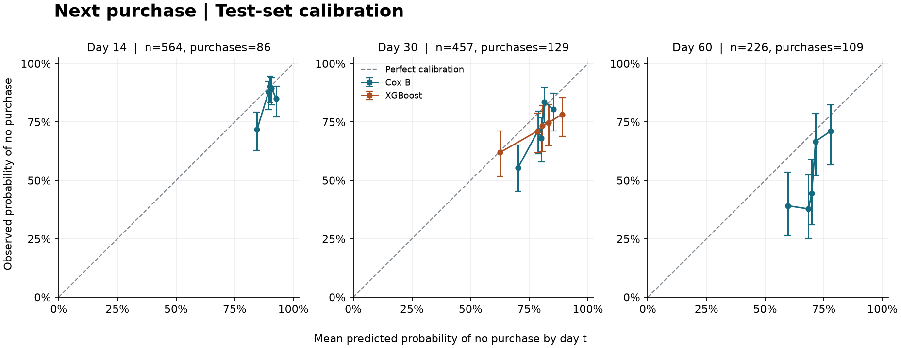

# Churn & Payment Prediction with Survival Analysis

基于 Online Retail II 的生存分析项目。第一阶段探索历史回溯末购事件；后续建模和预警的可验证目标是**从首购后第 14 天打分起，到下一笔有效购买的时间**。两者不是同一个标签，不把尚未购买解释为永久流失。

**建模人群**：数据从 2009-12-01 才开始，更早的购买看不到，早期「首次出现」的用户大多是老客户（藏起第一年做模拟，起点后首月表观新客中 91% 是老客户）。因此只纳入首次出现不早于 2010-05-30 的用户，即入组前至少 180 天无购买的**新客或沉睡回流客户**，共 3,176 人（剔除 2,702 人）。[左截断体检](reports/left_truncation.md)



**核心结果**（测试集 646 人 / 256 事件）：
C-index **0.6054** · 30 天 AUC **0.6395**（XGBoost 0.5798）· 校准高估未购买率 **+4.7 ~ +17.7pp**

排序有区分度，但概率未校准——这是本项目最想传达的一点。

## 演示

在仓库根目录运行（Python 3.12）：

```powershell
python -m venv .venv
pip install uv
uv pip install --python .venv/Scripts/python.exe --find-links vendor/wheels -r requirements.txt
python -m streamlit run app.py --server.address 127.0.0.1
```

`vendor/wheels/` 里是 `autograd-gamma` 的本地 wheel（PyPI 上只有 sdist），必须保留；仓库不含 uv 可执行文件。详见 [环境说明](ENVIRONMENT.md)。打开 `http://127.0.0.1:8501`。演示不需要原始数据：它用 [冻结 Cox 模型](models/cox_warning.json) 和合成用户展示四档分布、档位平均／单用户曲线和高风险名单下载。也可上传同口径的 UTF-8 CSV（最多 50,000 行），不需要标签。

上传字段：`user_id,n_invoices,first_order_amount,days_since_last_buy,n_products,top1_product_share`（以 [冻结模型](models/cox_warning.json) 的 `features` 为准）。请用原始字符串 ID、GBP、自然日和 0–1 比例；要求每人一行。特征按首购起至打分日前、共 14 天的窗口汇总，详见 [特征规范](reports/feature_spec.md)。不要向公开实例上传真实用户表。

## 方法与结果

- **训练与诊断**：按时间切分，标签不跨越各期截止日；特征筛选（仅训练集，VIF>5 剔除）后保留五个特征，仅用训练集拟合 Cox B，验证集 C-index 0.6416。Schoenfeld 主检验未检出显著比例风险违背，分层版本仅 +0.001，没有实质改善。[训练记录](reports/cox_training_notes.md) · [PH 实验](reports/cox_ph_experiment.md)
- **测试与校准**：646 人的完整测试集 Harrell C-index 为 0.6054（bootstrap 95% 区间 0.561–0.645）。457 人的同口径 30 天队列上，Cox B / XGBoost AUC 为 0.6395 / 0.5798；实际购买率 28.2%，Cox 平均预测 20.8%，即低估购买，60 天低估达 17.7 个百分点。[指标与校准图](reports/cox_evaluation.md)
- **分层与触达**：以 S(30) 和训练集分位切点分四档。实测未购买率按高到低为 81.2%、78.5%、73.0%、56.9%，严格单调，但相邻档区间重叠。历史名单有 151 位高档候选，上限 1,000，不跨档凑数。[分层表](reports/risk_tiers.csv) · [运营建议与试验设计](reports/operations_playbook.md)

全流程按顺序运行 `src/` 下的 `check_left_truncation`、`build_user_timeline`、`build_survival`、`analyze_km`、`build_cox_features`、`train_cox`、`check_cox_ph`、`evaluate_cox`、`build_warning`。如已有建模表，在仓库根目录运行 `./.venv/Scripts/python.exe -B src/build_warning.py` 可重生成模型、分层报告和 `reports/warning_list.csv`。名单含历史 ID，仅限本地，已设为不入库；可公开展示的是合成名单。测试命令：`./.venv/Scripts/python.exe -B -m unittest discover -s tests`。

## AI Usage

本项目在 AI 编码助手（DeepSeek）协作下完成。为避免夸大战绩或掩饰参与度，明确划分如下。

**AI 协助**
- 数据清洗、构表、KM / Cox / 校准 / 分层的代码实现与绘图
- 报告、文档、Streamlit 演示页的初稿
- 单元测试与回归用例的编写

**项目作者的判断（也是责任所在）**
- **问题定义**：选公开数据集、定两阶段路线、决定先做流失再做下一单
- **口径取舍**：7/14/30 天三口径对比后选 30 天；把主任务从「沉默即流失」改为「到下一笔购买的时间」
- **特征边界**：禁止使用全期消费、末购日、活跃天数等事后信息；品类字段不可信时改用商品数与集中度代理并明确标注
- **验收与纠错**：发现 99.66% 事件率的定义错误、T=0 被当作剔除依据、测试文件缺入口空转
- **结论把关**：如实保留发票数 HR 区间跨 1、校准偏差 4.7–17.7pp、分层无增益等负结果

**后续审查**
- 发现早期首次出现用户多为老客户（左截断），加入 180 天回看期并从原始数据全量重跑；回看期长度为可调参数

**可验证性**
- 全部数字可由 `src/` 下脚本从原始数据复跑，52 个测试覆盖口径边界
- 产物由脚本生成、不手工编辑（`logrank.csv` 曾被人工格式化，已修正）

**说明**
本段按「AI 提议 / 人确认」的实际分工书写，不声称代码为手写，也不把决策归给工具。

## 边界与发布

这是历史演示，不是当前业务队列或已验证的挽回方案。分数有排序用途，不是已校准的订单预测；高风险不等于干预有效。无有效首购、无客户 ID、特征窗未满、仅退款／取消的用户不能直接套用。建模人群混有沉睡 ≥180 天后回流的老客户，不能当作纯新客的结论。跨地区、渠道、时期或计量口径需重新验证。以同一历史留出集做的分层回测不是新的独立验证。

可将 `app.py` 作为 Streamlit 部署入口。公开部署前只发布源代码、冻结模型、汇总报告和合成样例，不携带原始数据、处理表或历史名单；公开 demo 应只用合成或经过授权的数据。代码已发布于 [GitHub](https://github.com/QAQ156272/churn-payment-survival)，未部署到公网。

## License

MIT。见 [LICENSE](LICENSE)。
