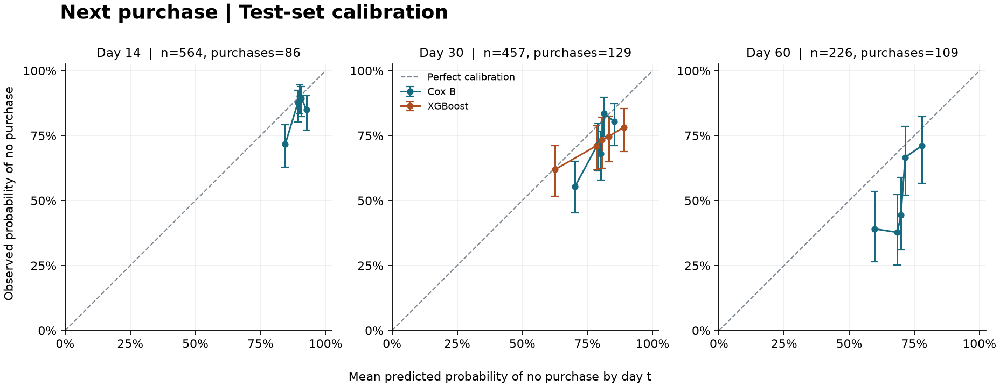

# 第二阶段第 4 步：C-index、校准与二分类基线

目标仍是打分后到下一笔有效购买的时间，不是流失；打分当天计第 1 天。采用第 3 步保留的原 Cox B，连同单特征 Cox A 在训练集无惩罚复拟合。XGBoost 使用固定配置；验证集和测试集不参与拟合、选特征、调参或校准。

**摘要：** Cox B 完整测试集 C-index 为 0.6054。在共同的 30 天队列上，Cox B / XGBoost 的 ROC AUC 分别为 0.6395 / 0.5798，平均预测购买率分别为 20.8% / 21.3%，实际为 28.2%。排序和概率误差需要分别判断。

## 完整测试集：Cox 排序能力

共 646 人、256 个事件、390 个右删失。用部分风险和原始 T/E 计算 Harrell C-index。该值反映可比较对的排序，受删失模式影响。

| 模型 | Harrell C-index |
|---|---:|
| Cox A（购后间隔） | 0.5464 |
| Cox B（六特征） | 0.6054 |

## 同口径对照：30 天内是否购买

只纳入打分日起到标签截止日有至少 30 个自然日的用户。是否入组只看日期，不看是否提前购买。第 30 天购买算正例，更晚购买或完整观察 30 天仍未购买算负例。测试时，两模型在同一批用户上使用同样的六个打分前特征。Cox 保留完整训练集，分类器仅使用完整窗口，结果是两套建模流程的对照，不能把差异单独归因于算法。

- XGBoost 二分类训练：1966 人，397 个正例。
- XGBoost CPU 3.1.3：`objective=binary:logistic`, `eval_metric=logloss`, `tree_method=hist`, `n_estimators=150`, `max_depth=3`, `learning_rate=0.05`, `random_state=42`, `n_jobs=1`。
- 六特征：n_invoices, first_order_amount, days_since_last_buy, n_products, top1_product_share。

| 模型 | C@30 ↑ | ROC AUC ↑ | AP ↑ | Brier ↓ | 平均预测购买率 |
|---|---:|---:|---:|---:|---:|
| Cox B | 0.6223 | 0.6395 | 0.4368 | 0.1986 | 20.8% |
| XGBoost | 0.5696 | 0.5798 | 0.3872 | 0.2018 | 21.3% |

C@30 在第 30 天截断随访，按两模型各自的 30 天购买概率给用户排序。它还比较窗口内谁更早，ROC AUC 则只区分正负例。完整随访 C-index 与 C@30 不可直接比较；XGBoost 没有输出完整生存曲线。

同一批测试用户上，XGBoost − Cox B：C@30 -0.0527，ROC AUC -0.0597，Brier +0.0031。这些是单一时间切分的点估计，不是显著性结论。

## 校准：到某一天还没买的人有多少

每个时间点只看计划随访覆盖该日的测试用户。按各模型预测的未购买概率近似等频分为至多五组（相同预测值不拆组），比较组内平均预测和实际未购买比例。窗口内无提前删失，因此实际比例等于该组同一时间点的 Kaplan–Meier 估计。误差线是观测比例的 95% Wilson 区间，不包含训练不确定性。点在线下表示高估未购买比例，也就是低估购买率。

| 天数 | 可评估人数 | 已购买 | 实际未购买 | Cox B 预测未购买（均值） | 预测减实际 |
|---:|---:|---:|---:|---:|---:|
| 14 | 564 | 86 | 84.8% | 89.5% | +4.7 pp |
| 30 | 457 | 129 | 71.8% | 79.2% | +7.4 pp |
| 60 | 226 | 109 | 51.8% | 69.4% | +17.7 pp |

长窗口排除了更多晚入组用户，不能把上表跨行读成同一批人的实际生存曲线。没有用测试结果重新校准模型。

## 生存模型多给了什么

- 30 天二分类回答「会不会在 30 天内买」，不直接回答「什么时候买」。
- Cox 给出整条时间曲线，同一模型可估算不同触达窗口的购买概率。比如第 14 天结束还没买的人，在第 15 至 30 天购买的模型概率为 `1 - S(30)/S(14)`。这不是触达本身的因果效果。
- Cox 训练保留右删失用户截至截止日的在险信息；固定窗口基线需要确认窗口内的二分类标签。能给出多时间点预测不等于概率已足够准，投放前应在新时间段核对校准。

复跑：`./.venv/Scripts/python.exe -B src/evaluate_cox.py`。分箱明细见 `cox_calibration_bins.csv`。
